# Infraestructura de autenticación RADIUS (WPA2-Enterprise)

Informe técnico del proyecto FreeRADIUS 3.2.10 + TP-Link TL-WR840N. Autenticación 802.1X (PEAP/MSCHAPv2): el router delega la validación de usuarios en el servidor RADIUS.

## 01 Arquitectura y Requisitos

```
[Cliente Android]  --EAP-PEAP-->  [Router TL-WR840N]  --RADIUS UDP 1812/1813-->  [Servidor FreeRADIUS]
   usuario juan                     192.168.0.1 (NAS)       secreto compartido        192.168.0.102
        ^----------------- Access-Accept / Access-Reject <------------------------------+
                           Servidor NTP (UDP 123) sincroniza la hora del servidor
```

| Componente | Detalle |
|---|---|
| Servidor | FreeRADIUS 3.2.10 (laboratorio en Kali; perfil producción: CentOS) |
| NAS | TP-Link TL-WR840N, WPA2-Empresarial, AES |
| Cliente | Android, PEAP + MSCHAPv2 |

**Requisitos:** IP fija del servidor, UDP 1812/1813 abiertos hacia el router, hora sincronizada (NTP), secreto idéntico en ambos lados, mínimo dos usuarios.

## 02 Despliegue y Configuración

Ejemplos de configuración en [`config/`](config/).

**Servicio operativo: *Ready to process requests*.**
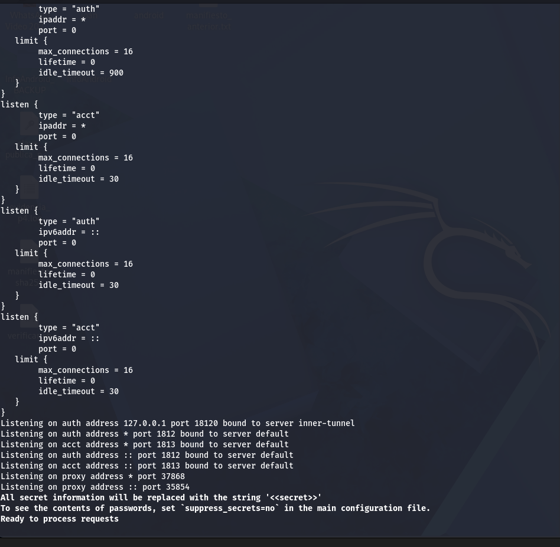

**Router registrado como cliente (`clients.conf`).**
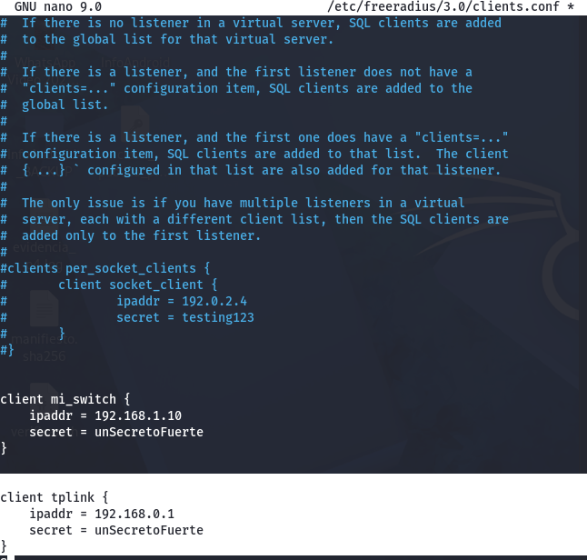

**Usuarios `juan` y `maria` (`users`).**
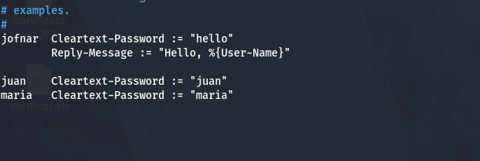

**WPA2-Empresarial en el TL-WR840N apuntando a 192.168.0.102:1812.**
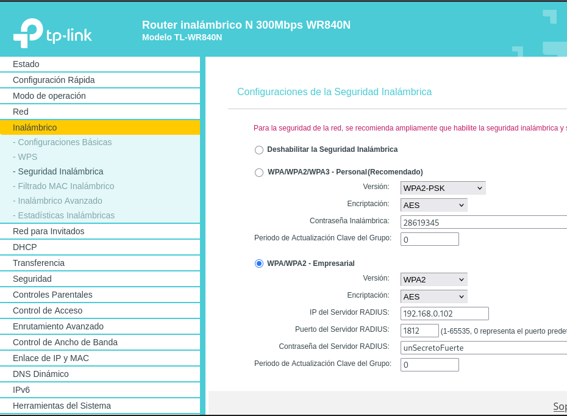

**Cliente Android: PEAP / MSCHAPv2, identidad `juan`, estado Conectado.**
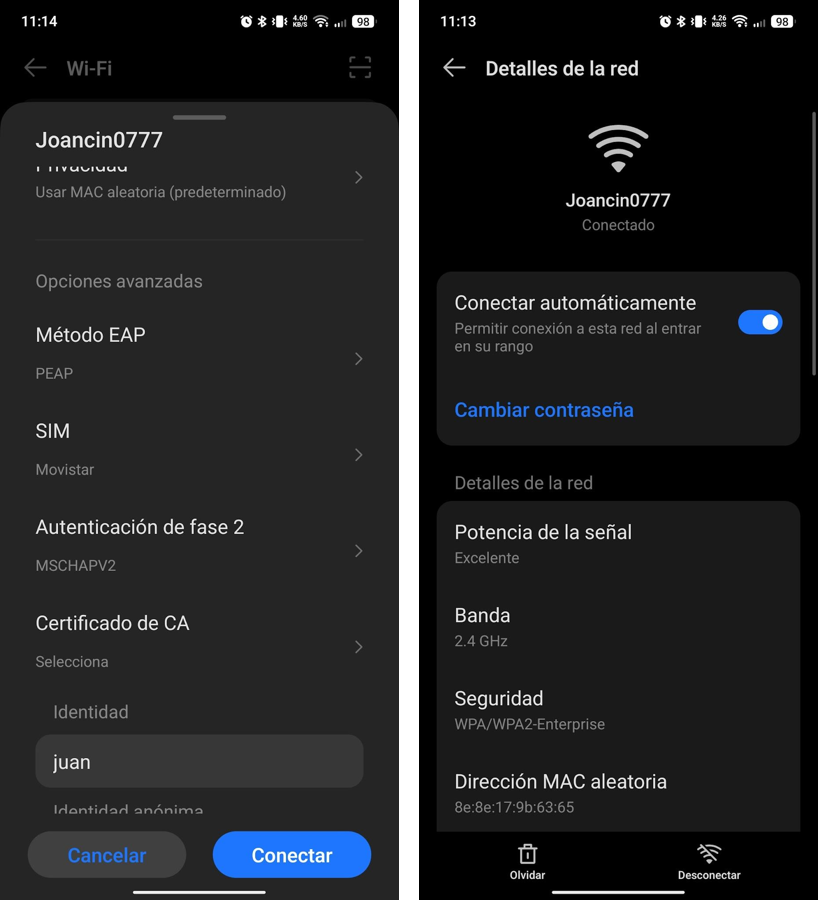

## 03 Aseguramiento Seguridad SELinux/Firewall

| Servicio | Puerto | Estado | Regla firewalld |
|---|---|---|---|
| RADIUS auth / acct | 1812, 1813/UDP | Desplegado | `--add-service=radius` |
| NTP | 123/UDP | Desplegado | `--add-service=ntp` |
| HTTP / HTTPS | 80, 443/TCP | Referencia | `--add-service=http --add-service=https` |
| FTP | 21, 20/TCP + pasivo 30000-31000/TCP | Referencia | `--add-service=ftp --add-port=30000-31000/tcp` |

Script de referencia: [`config/firewalld-centos.sh`](config/firewalld-centos.sh).

- SELinux en *Enforcing*; nunca `setenforce 0`.
- Etiquetas: `restorecon -Rv /etc/raddb`; bloqueos: `ausearch -m avc -ts recent`.
- FTP hacia el directorio web: contexto `public_content_rw_t` con `semanage fcontext` + `restorecon`.

**Firewall del laboratorio (Kali): políticas en ACCEPT, sin reglas. Endurecer en producción.**
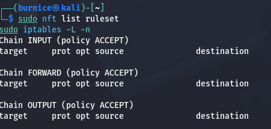

## 04 Pruebas de Aceptación y Troubleshooting

**TC-01 · `freeradius -CX` → Configuration appears to be OK**
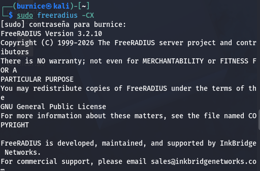
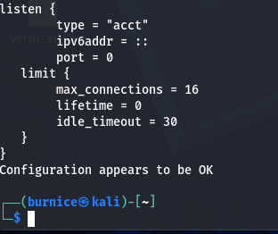

**TC-02 · `systemctl status freeradius` → active (running)**
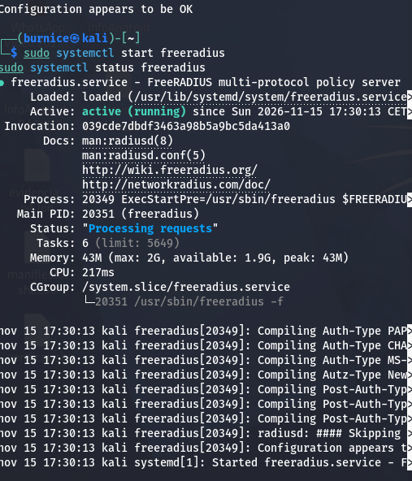

**TC-03 · `ss -lunp` → 1812/1813 en escucha**
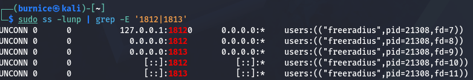

**TC-04 · `radtest juan juan localhost 0 <secreto>` → Access-Accept**
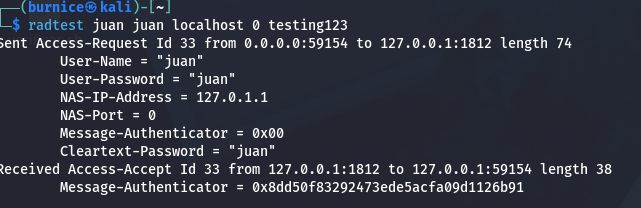

**TC-05 · clave incorrecta → Access-Reject**
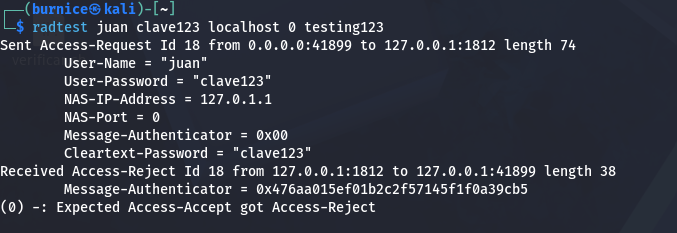

**Accounting (1813) → Accounting-Response**
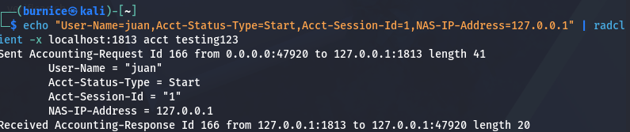

**Carga · `radclient -c 100 -p 10` → 100 peticiones, 10 en paralelo**
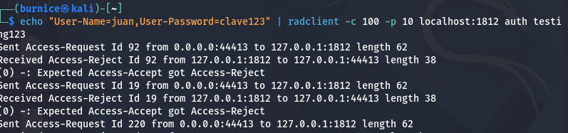

**TC-06 · `freeradius -X` → rechazo de sesión PEAP en el debug**
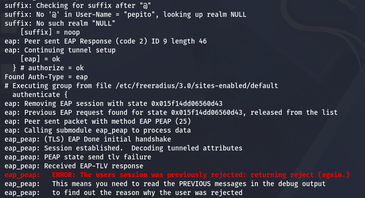

**TC-07 · `tcpdump -ni eth0 host 192.168.0.1` → tráfico real del router**
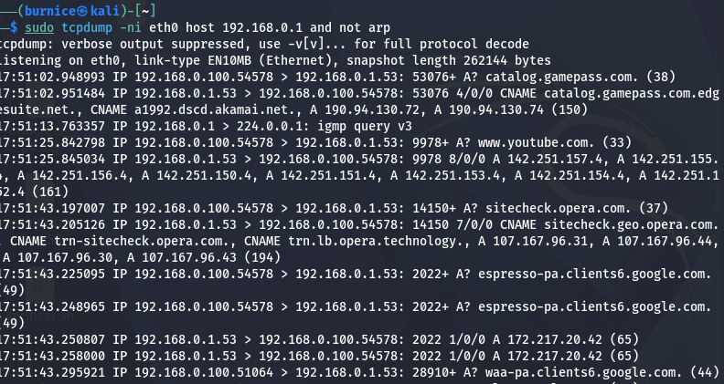

**TC-08 · `timedatectl` → System clock synchronized: yes**
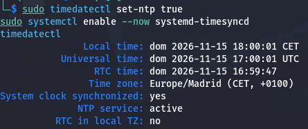

**TC-10 · `ss -lunp` → puertos 1812/1813 en escucha tras las verificaciones**
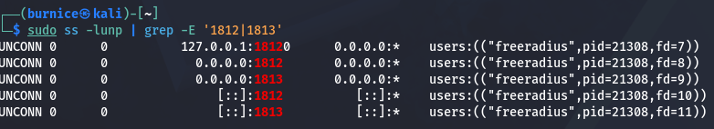

Para HTTP/FTP/NTP en producción: `ntpq -p`, `curl -I http://servidor` (200) y `curl -T archivo ftp://servidor/` (pasivo) o `--ftp-port -` (activo).

### Contingencia: 3 errores más comunes

| Problema | Causa | Solución |
|---|---|---|
| Router no llega al RADIUS (*unknown client*) | Firewall, IP o secreto distintos | `firewall-cmd --add-service=radius`; igualar IP y secreto; `tcpdump -ni eth0 udp port 1812` |
| SELinux bloquea lectura o escritura | Etiquetas erróneas | `ausearch -m avc`; `restorecon -Rv /etc/raddb`; nunca `setenforce 0` |
| Error de certificado con clave correcta | Reloj desfasado | `timedatectl`; `systemctl enable --now chronyd`; regenerar con `make destroycerts && make` |
